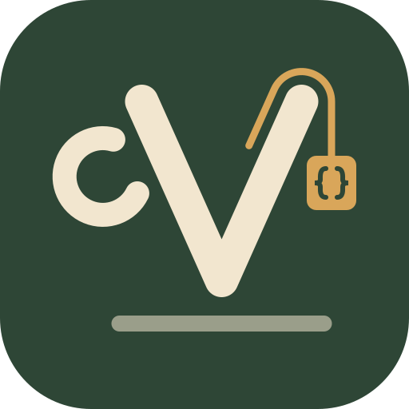

<p align="center"></p>

# BrewCV

You keep one career record. For each job, you make a CV from wordings you already wrote. BrewCV never writes your bullets for you.

<!-- The GIF of tailoring one CV goes here once it's recorded, as docs/brewcv.gif:


-->

**[Open BrewCV →](https://MDomokos.github.io/brewcv/)**

It runs in your browser, works offline, comes in ten languages, and [never uploads your data](docs/PRIVACY.md).

## Why

Most people end up with ten near-identical Word and PDF files, one per application, each a little out of date. BrewCV keeps **everything you've done in one JSON file**. Each resume is a **selection** from that file: which lines are in, and which wording each one uses.

1. **Write each job once.** Every claim is stated once in your career record.
2. **Keep several wordings.** A line can have several versions (v1, v2, v2.1…), each in as many languages as you need.
3. **Pick one per resume.** Each tailored resume picks a version of each line. If you edit a wording once, every resume that uses it is offered the update.
4. **Export.** Print to PDF, or save as an HTML page, plain text, or JSON Resume, in the language you choose.

## Features

- **Edit on the page.** Click a bullet to open its job, click again to write the line where it is printed. The job is framed, the rest dims, and the tools (the version badge, Update, Save as new version, Only on this resume) sit beside the line. Esc goes up one level: line, job, page.
- **Pages on one canvas.** A two-page resume shows both pages at once when the window is wide enough, and one at a time otherwise. Pan with Space and drag, zoom with a pinch, and Esc at the page level puts everything away.
- **Tea or coffee.** Two workspaces, each in light and dark (see below).
- **One career record, many tailored resumes.** A tailored resume holds which bullets are on, which version each one prints, the section order and headings, the paper and the design.
- **Fit.** It picks shorter versions and leaves out bullets until the last page is 88–96% full. Fit never rewrites your prose: it only chooses among versions you wrote, and tells you what it couldn't fit.
- **Tags and job-type focus.** Tag versions, then select every bullet that matches a job type or tag in one step. One undo reverses it, and bullets marked *Keep* are never touched.
- **Ten languages**, in the app and in every line: English, German, French, Spanish, Italian, Portuguese, Dutch, Polish, Czech and Hungarian. Switching language also switches an A4 resume to that country's A4 format. A line with no translation yet prints in English, outlined, so you can spot it.
- **Design.** One page, two, or as many as needed. Letter or A4, four templates, an accent colour with a live contrast check, and importable themes (CSS, JSON or DTCG design tokens). Photos are cropped to 35 × 45 mm, with a note on which countries expect one.
- **Export.** Pre-flight checks run first. Then you get a **PDF** (print, with the page size set), a self-contained **HTML page**, **plain text for ATS**, **JSON Resume**, or a full **backup**.
- **Import and merge.** Open a JSON Resume, a BrewCV record or backup, a saved resume, a theme or a photo. You can drop or paste it too. If a record is already open, a **merge preview** shows what would change before anything does. Edits made to the file in another tool, including an AI, come back as new versions.
- **Tailor with a coding agent.** [AGENTS.md](AGENTS.md) tells any coding agent how to go from a job ad to a saved resume and a PDF using only wordings that are already in your record. It picks versions and never writes or edits one, unless you ask it to; wording it thinks would help comes back as a list for you to consider.
- **Undo and history.** Every change can be undone (200 steps). A checkpoint is saved before every import, merge or restore. You can compare a checkpoint with now, restore it, or download it.
- **Actual size.** After a one-time calibration with a bank card, the page is drawn at its printed size.
- **On a phone** you can view resumes and pick versions. Editing needs a larger screen.

## Tea or coffee

The app asks "What are you drinking today?" and keeps your answer. Shift+F switches in place, with no reload. Each drink has a light and a dark look, which follow your system unless you choose one in Settings. The resume itself prints the same either way.

- **Tea** is the default: a deep green panel, amber accents, a bamboo mat under the page, and a V-shaped cup that fills as the page does. Steam rises when the page reaches Fit's band.
- **Coffee** is for getting it done: monospace type, square corners, no shadows, one crema accent, and a measuring shot glass for the page's fill.

While you rest in tea, the mat comes alive: leaves and petals drift down and settle, rain leaves wet spots, and a ladybug, a snail and a butterfly pass through. Nothing moves while you work. A click into the resume or a key press sweeps the page clear. It is off in coffee, on a phone, with reduced motion and on the start screen, and *Garden while you rest* in Settings turns it off.


## How it differs from other tools

Most resume tools that tailor for a job do it by changing your wording. BrewCV only picks from wordings you wrote. These are the closest ones:

| Tool | What it does with your wording | Where it runs |
|---|---|---|
| [Teal](https://www.tealhq.com) | You enter your experience once and switch items on or off for each resume. Its AI offers rewrites of an achievement. | A hosted service, with a paid plan. Your data is on their servers. |
| [Resume Matcher](https://github.com/srbhr/Resume-Matcher) | You upload a master resume and paste a job ad. An AI model rewrites your bullets to fit and scores the match. | Open source. You run a server and connect an AI model, local or hosted. |
| [Reactive Resume](https://github.com/AmruthPillai/Reactive-Resume) | A good editor with one wording per item. Its AI tailors a copy and drafts a cover letter, and an outside agent can edit a resume through its MCP server. | Open source. Self-hosted, with Docker and a database. |
| [career-ops](https://github.com/santifer/career-ops) | Runs inside a coding agent. You paste a job ad and it writes a tailored CV from your notes, then checks that the numbers match your sources. | Open source. A coding agent plus your files. |

BrewCV never rewrites a line. A bullet can have several versions that you wrote, and a resume picks one. **Fit** chooses among them to fill the page, and tells you what it couldn't fit. There is no server, no account and no API key, and nothing to build: it's plain files that open in a browser.

What those tools have that BrewCV doesn't: cover letters, Word export and application tracking.

## Your data stays yours

- **Private.** Everything stays in your browser. There is no account, no server and no upload. The page also carries a rule that makes your browser refuse any request to another address, and you can [check it yourself](docs/PRIVACY.md).
- **Standard files.** Every file it writes is valid [JSON Resume](https://jsonresume.org/schema). Versions, languages and tags live under `meta.resumeBuilder`. A saved resume is a JSON Resume file of the resume as printed, so any JSON Resume community theme can render it.
- **Why JSON?** It's plain text that any device, editor or tool can open, now and in twenty years. An AI can read and rewrite it directly: tighten wording, translate, spot gaps. And it follows the idea of [file over app](https://stephango.com/file-over-app): your content is a file you own, not data locked inside an app.
- **No lock-in. Back up!** Your work is saved in the browser on every change, but browser storage can be cleared. Use *⋯ › Back up* to download everything in one file, or *⋯ › Link a folder* (Chrome, Edge) to mirror your record to `resume-data.json`, and each saved resume to `recipes/`, on your disk.

Don't take that on trust. [docs/PRIVACY.md](docs/PRIVACY.md) shows how to watch the network tab yourself in Chrome, Brave, Firefox or Safari, and explains the browser rule in the page that stops it talking to anyone but its own address.

## Getting started

1. Open **[the app](https://MDomokos.github.io/brewcv/)**.
2. Choose how to start:
   - **Start from scratch.** It asks a few questions (about five minutes) and fills the page as you type.
   - **Open or import a file.** A JSON Resume, a backup, or a BrewCV record.
   - **Try it with an example.** A finished, fictional record with fourteen tailored resumes across all ten languages.

   The start screen shows how it works in one picture: old resumes into one record, the record into a page, the page into a resume for each job.
3. **Install it** (optional): use your browser's *Install app* / *Add to Home Screen*. Once installed it works offline.

Click a bullet on the page to open its job, and click again to edit it. Press ? for the keyboard shortcuts.

## Other ways out

These happen outside the app and don't need anything installed in it.

<details>
<summary><b>Open in Figma</b> (one way)</summary>

1. *Export › HTML page*.
2. In Figma, run the **html.to.design** plugin and paste the file's contents into its code tab. The page becomes editable layers.
3. Finish the design there, and export a PDF from Figma.

Changes made in Figma don't come back into the editor. Make wording changes in the editor first, then export again. To change only colours and type and keep them in the app, use the theme route in [`figma/README.md`](figma/README.md) instead: tokens go to Figma Variables and come back.

</details>

<details>
<summary><b>JSON Resume community themes</b></summary>

1. *Export › JSON Resume*. This is the resume as printed, with one version per bullet. (A saved resume's file in `recipes/` is already one.)
2. Install the CLI and a theme:
   ```
   npm install -g resumed
   npm install jsonresume-theme-even
   ```
3. Render it, then print the HTML to PDF:
   ```
   resumed render resume.json --theme jsonresume-theme-even
   ```

What you lose on the way:

- **Fit and page control.** The theme lays the page out its own way.
- **The photo and language support**, which vary by theme.
- **Other languages.** Only the resume's own language is exported.

Each theme has its own licence. Check it before you publish what it renders.

</details>

## Making your own theme

A theme changes colour, type and spacing, never the layout. You can make one from a tokens file, in Figma, in CSS, or with an AI model's help. [docs/THEMES.md](docs/THEMES.md) has the four routes and what to run to check the result.

## Translations need native speakers

English is the original. **Nine of the ten interface languages were written by a machine**, and so were eight of the example resumes. They may have mistakes or read stiffly, and the app tells you so when you choose one.

If you're a native speaker, you can correct one:

1. Run `node scripts/i18n-review.mjs de` (use your language code: `de`, `fr`, `es`, `it`, `pt`, `nl`, `pl`, `cs`, `hu`). It writes a spreadsheet to `out/i18n-review/de.csv` with the English, the current text and an empty *corrected* column. Open it in Excel, Numbers or any spreadsheet, and fill in *corrected* wherever the current text is wrong.
2. Run `node scripts/i18n-review.mjs --apply out/i18n-review/de.csv` to write your corrections into `src/i18n/de.js`.
3. Open a pull request with that file. Or, if you'd rather not use git, attach the spreadsheet to an issue and a maintainer can apply it.

You only need Node for that, with nothing to install. The file keeps its machine-written marker until someone has reviewed the whole language.

## Running it yourself

There's nothing to build: it's plain HTML, CSS and JavaScript, with no framework and no dependencies. Serve the folder over HTTP:

```
python3 -m http.server 8000     # then open http://localhost:8000/
npx serve                       # if Node is closer to hand
```

Browsers won't load ES modules from `file://`, so opening `index.html` straight from disk shows a note saying so. An exported HTML resume has no script, so it opens from disk anywhere.

To host your own copy, fork the repo and enable GitHub Pages with *GitHub Actions* as the source. `.github/workflows/pages.yml` publishes on every push to `main`.

## Contributing

Pull requests are welcome, and so are corrections to a translation. [CONTRIBUTING.md](CONTRIBUTING.md) says how to run the checks and what a change needs. Changes are listed in [CHANGELOG.md](CHANGELOG.md).

## Why the name

"CV" is the word for a resume in all ten of the app's languages. And you brew a fresh one from the same record for each job, the way you'd steep the same tea for a different cup.

## Acknowledgements

- [JSON Resume](https://jsonresume.org) (MIT): the schema's field vocabulary and date format.
- [Resume Matcher](https://github.com/srbhr/Resume-Matcher) (Apache-2.0): the idea of reporting job-ad keywords your resume doesn't cover. It was reimplemented from scratch, with no network calls and no LLM.

No code from any other project is vendored or copied. Projects that were looked at and deliberately not used are listed in [docs/DEVELOPMENT.md](docs/DEVELOPMENT.md#prior-art-and-what-was-taken-from-it).

## License

Copyright (C) 2026 the BrewCV contributors.

BrewCV is free software under the [GNU Affero General Public License](LICENSE), version 3 or any later version (`AGPL-3.0-or-later`). You can use it, change it and share it. If you run a modified copy as a service that other people use over a network, you must offer those people the source of your version. The app's menu links to the source for this reason.

The fonts in `fonts/` (Hanken Grotesk and Fira Code) are under the SIL Open Font License; their licences are beside them.
