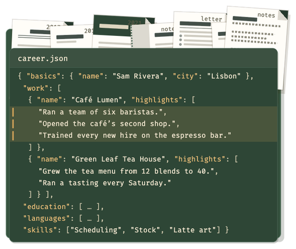
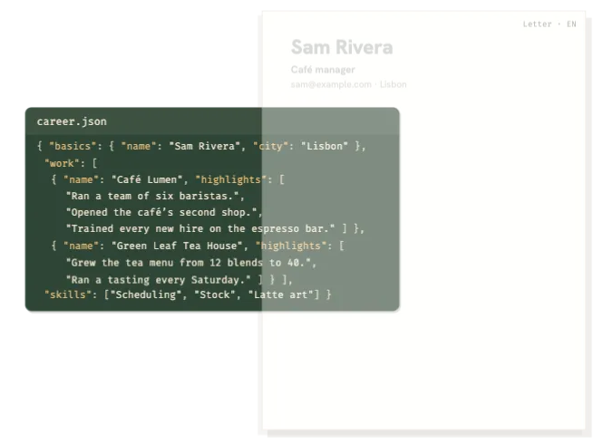
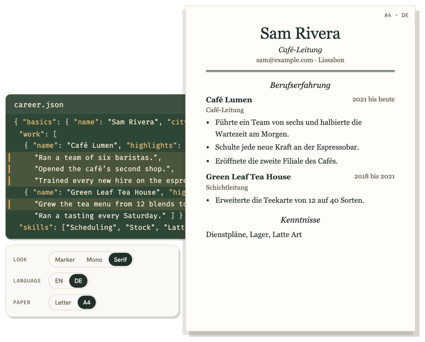
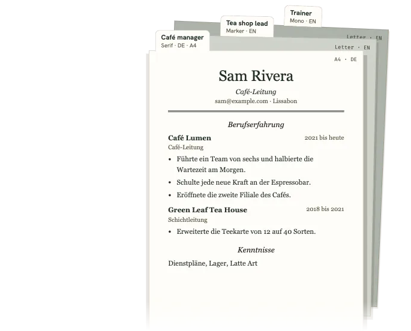

<p align="center"></p>

# BrewCV

Write your career down once. For each job, pick the wordings that fit. BrewCV never writes your bullets for you, and your data never leaves your device.

**[Open BrewCV →](https://MDomokos.github.io/brewcv/)** &nbsp;·&nbsp; no account, no install, works offline, ten languages

<table>
<tr>
<td align="center"><br><b>Bring it all in</b></td>
<td align="center"><br><b>Pick the wordings</b></td>
</tr>
<tr>
<td align="center"><br><b>Same words, any look</b></td>
<td align="center"><br><b>One resume per job</b></td>
</tr>
</table>

## The idea

Most people end up with ten near-identical Word files, one per application, each a little out of date. BrewCV replaces them with:

- **One career record.** Every claim, written once.
- **Several versions of each line.** A short one, a long one, one with numbers, one in German. They are all yours.
- **A resume is just a selection.** It says which lines are in and which version each one uses. Fix a wording once and every resume that uses it is offered the update.

**Fit** fills the page for you, but only by choosing among versions you already wrote: a shorter one here, a bullet left out there. It never rewrites anything, and it tells you what it changed.

## Your files stay your own

- **Nothing is uploaded.** No account, no server, no tracking. The page tells your browser to refuse any request to another address, and you can [watch the network tab yourself](docs/PRIVACY.md).
- **Plain files, standard format.** Everything is [JSON Resume](https://jsonresume.org/schema) with versions, languages and tags added. Open it in any editor, today or in twenty years. It's [file over app](https://stephango.com/file-over-app).
- **One-file backup.** *⋯ › Back up* downloads your record and every saved resume as a single file. Chrome and Edge can also mirror them to a folder on your disk.
- **Every change is undoable, and history is yours.** 200 undo steps, plus a checkpoint before any import or merge that you can compare, restore or download.
- **Export anywhere.** PDF, a self-contained HTML page, plain text for ATS, JSON Resume.

<details>
<summary><b>How privacy is enforced, not just promised</b></summary>

- Your record lives in your browser's storage on this device and is saved on every change. Browser storage can be cleared, so back up.
- The only requests the page makes are for its own code, fonts and the example. Whoever hosts it sees that you opened it, as with any site. Nothing goes back.
- A content-security rule in the page limits connections to its own address, so even a bug could not send your data elsewhere.
- [docs/PRIVACY.md](docs/PRIVACY.md) has click-by-click steps for Chrome, Brave, Edge, Firefox and Safari.
- BrewCV is [AGPL-3.0](LICENSE) free software, so you can read exactly what it does.

</details>

<details>
<summary><b>How versions work</b></summary>

- A line can have many versions (v1, v2, v2.1…), each in as many of the ten languages as you like, with tags such as a job type.
- Each saved resume stores only *which* version of each line it prints, plus layout settings. Edit on the page and the change is kept on that resume, and you choose whether to save it as a new version or update the old one.
- Select every bullet for a job type or tag in one step. One undo reverses it, and lines marked *Keep* are never touched.
- A line with no translation prints in English, outlined, so you can spot it.
- Import a file edited elsewhere, by hand or by an AI, and the changes arrive as new versions after a **merge preview**. Nothing is overwritten.

Details: [docs/TAGS-AND-JOB-TYPES.md](docs/TAGS-AND-JOB-TYPES.md).

</details>

## What you get

- **Edit on the page.** Click a bullet, click again, and write it where it prints.
- **Design.** Letter or A4, one page or several, five looks, an accent colour with a live contrast check, importable themes. Photos are cropped to 35 × 45 mm for countries that expect one.
- **Ten languages** in the app and in every line: English, German, French, Spanish, Italian, Portuguese, Dutch, Polish, Czech, Hungarian.
- **Tea or coffee.** Two light-and-dark looks for the app itself (the printed resume is the same either way).
- **A coding agent can tailor for you.** [AGENTS.md](AGENTS.md) walks an agent from a job ad to a PDF using only your existing wordings. It picks, and never writes, unless you ask.
- **Desktop app (experimental).** A macOS build that saves PDFs directly and links a folder, and a Windows build you can make on GitHub. The web version is the main one.

## Getting started

1. Open **[the app](https://MDomokos.github.io/brewcv/)**.
2. Start from scratch (about five minutes of questions), open a JSON Resume or backup, or try the fictional example with fourteen resumes in ten languages.
3. Optional: use your browser's *Install app* to keep it offline.

Press **?** for keyboard shortcuts. On a phone you can view resumes and pick versions; editing needs a larger screen.

<details>
<summary><b>Compared with other tools</b></summary>

Most tailoring tools change your wording with an AI. BrewCV only picks from wordings you wrote.

| Tool | What it does with your wording | Where it runs |
|---|---|---|
| [Teal](https://www.tealhq.com) | Switch items on or off per resume; AI offers rewrites. | Hosted, paid plan. Your data is on their servers. |
| [Resume Matcher](https://github.com/srbhr/Resume-Matcher) | An AI model rewrites your bullets to fit a job ad. | Open source; you run a server and connect a model. |
| [Reactive Resume](https://github.com/AmruthPillai/Reactive-Resume) | One wording per item; AI tailors a copy. | Open source, self-hosted with Docker and a database. |
| [career-ops](https://github.com/santifer/career-ops) | A coding agent writes a tailored CV from your notes. | Open source; an agent plus your files. |

BrewCV has no server, account or API key. What the others have that it doesn't: cover letters, Word export and application tracking.

</details>

<details>
<summary><b>Other ways out: Figma and JSON Resume themes</b></summary>

**Figma (one way).** *Export › HTML page*, then run the **html.to.design** plugin in Figma and paste the file. Changes in Figma don't come back; for colours and type use the theme route in [`figma/README.md`](figma/README.md).

**JSON Resume community themes.** *Export › JSON Resume*, then:

```
npm install -g resumed
npm install jsonresume-theme-even
resumed render resume.json --theme jsonresume-theme-even
```

You lose Fit, page control, the photo and other languages (only the resume's own language is exported). Check each theme's licence before publishing.

</details>

<details>
<summary><b>Make your own theme</b></summary>

A theme changes colour, type and spacing, never the layout. Make one from a tokens file, in Figma, in CSS, or with an AI's help. See [docs/THEMES.md](docs/THEMES.md) and [docs/THEME-DESIGN-RULES.md](docs/THEME-DESIGN-RULES.md).

</details>

<details>
<summary><b>Translations need native speakers</b></summary>

English is the original. Nine of the ten interface languages were machine-written and are marked as such in the app. To correct one, you need only Node:

1. `node scripts/i18n-review.mjs de` (or `fr`, `es`, `it`, `pt`, `nl`, `pl`, `cs`, `hu`) writes a spreadsheet to `out/i18n-review/de.csv`. Fill in the *corrected* column.
2. `node scripts/i18n-review.mjs --apply out/i18n-review/de.csv` writes your corrections into `src/i18n/de.js`.
3. Open a pull request, or attach the spreadsheet to an issue.

</details>

<details>
<summary><b>Run it yourself</b></summary>

There's nothing to build: plain HTML, CSS and JavaScript, no framework, no dependencies. Serve the folder over HTTP:

```
python3 -m http.server 8000     # then open http://localhost:8000/
npx serve                       # if Node is closer to hand
```

Browsers won't load ES modules from `file://`. An exported HTML resume has no script, so it opens from disk anywhere. To host a copy, fork the repo and enable GitHub Pages with *GitHub Actions* as the source; `.github/workflows/pages.yml` publishes on every push to `main`. Desktop builds are described in [docs/DEVELOPMENT.md](docs/DEVELOPMENT.md#desktop-build-macos-preview).

</details>

## Contributing

Pull requests and translation fixes are welcome. See [CONTRIBUTING.md](CONTRIBUTING.md). Changes are listed in [CHANGELOG.md](CHANGELOG.md).

## Why the name

"CV" is the word for a resume in all ten of the app's languages. And you brew a fresh one from the same record for each job, the way you'd steep the same tea for a different cup.

## Acknowledgements and license

- [JSON Resume](https://jsonresume.org) (MIT): the schema's field vocabulary and date format.
- [Resume Matcher](https://github.com/srbhr/Resume-Matcher) (Apache-2.0): the idea of reporting job-ad keywords your resume doesn't cover, reimplemented from scratch with no network calls and no LLM.

No code from other projects is copied. See [docs/DEVELOPMENT.md](docs/DEVELOPMENT.md#prior-art-and-what-was-taken-from-it).

Copyright (C) 2026 the BrewCV contributors. BrewCV is free software under the [GNU Affero General Public License](LICENSE), version 3 or later. If you run a modified copy as a network service, you must offer its users your source. The fonts in `fonts/` (Hanken Grotesk, Fira Code) are under the SIL Open Font License.
