# BrewCV in motion

Short recordings of BrewCV, made on the example data (a fictional person), of the moments where the page moves to show what changed. All of it turns off under your system's reduced-motion setting, and Settings has its own switch. The printed resume never changes.

## Fit

Fit crossfades its swapped lines, folds the dropped ones, fills the page meters and leaves a chip, "1 shorter · 14 left out", with Undo.

## A version under the pointer

A version under the pointer moves its words: shared words slide to their new place, removed words fade out and new ones fade in.

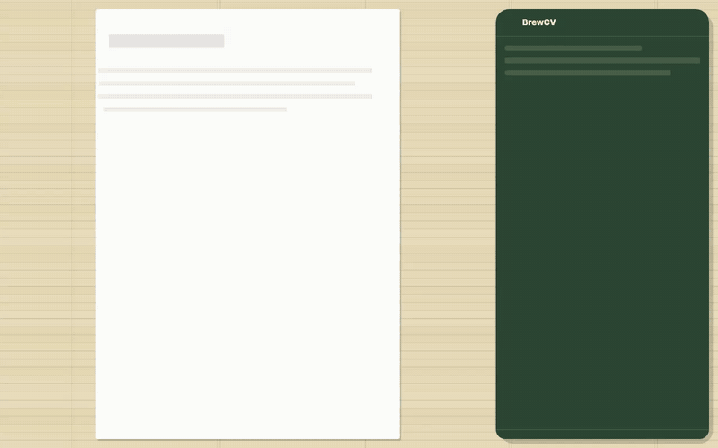

## The lens and Apply

The lens brightens its lines, and Apply slides lines in and folds them away.

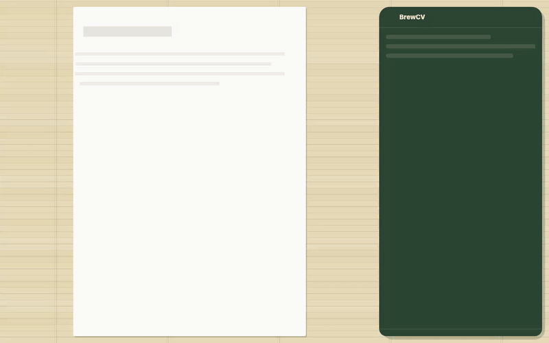

## A tick sends the line to the page

A tick sends the line from its row in the record to the page, and back when you untick it.

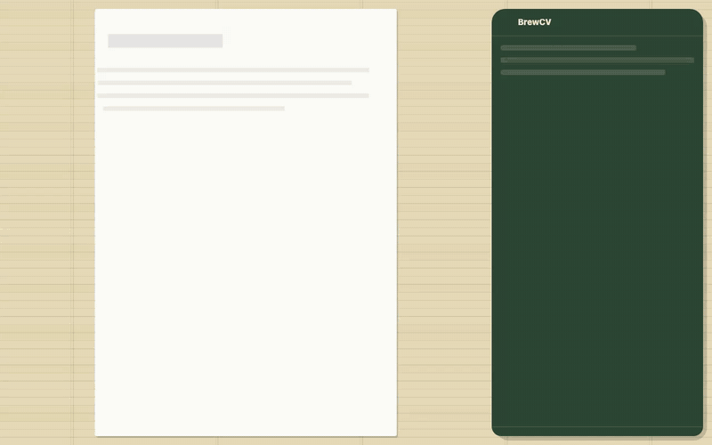

## Writing a line where it is printed

One click on a bullet opens its job, a second writes the line where it is printed. The page zooms to the line, the rest dims, and the version badge and the tools sit beside it.

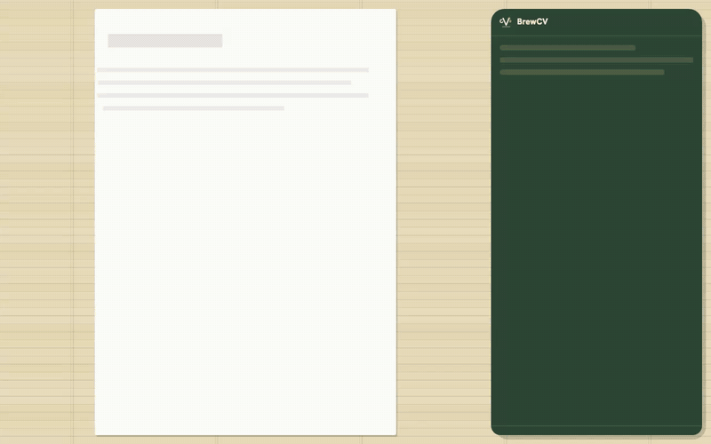

## A snapshot, and where it was sent

A snapshot drops a small page into the resume's name, and a "Sent to" line appears under it.

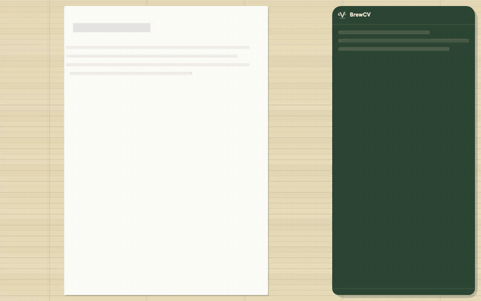

## Save as new version

A saved version slides into the list of versions.

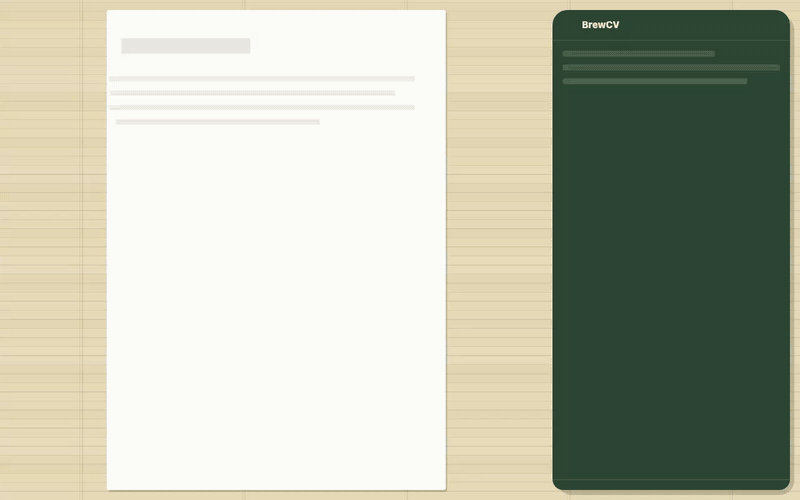

## A page that overflows

A page that overflows fades its dashed edge in, where the next page begins.

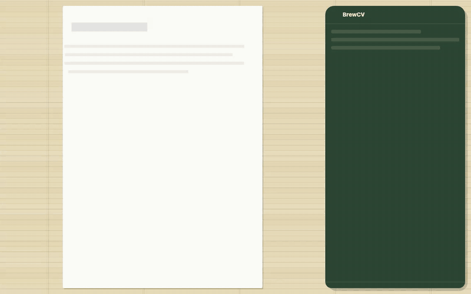

## Switching resume

Switching resume crossfades the page.

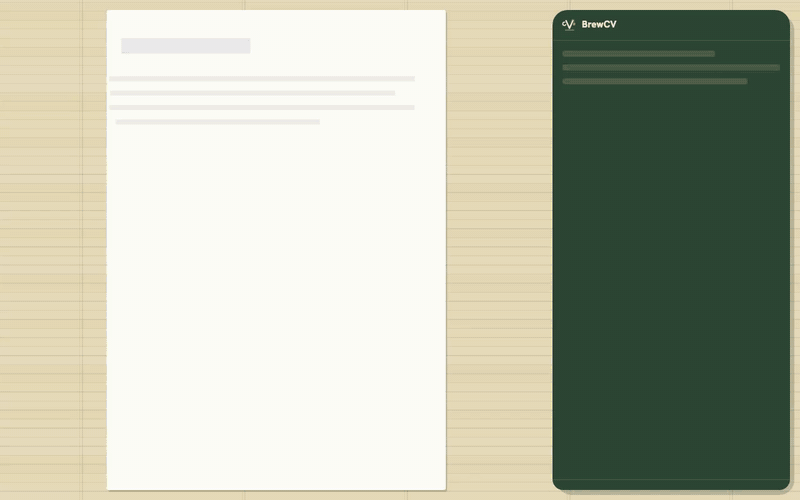

## From the start screen to the editor

The start screen turns into the editor: its areas are the editor's areas.

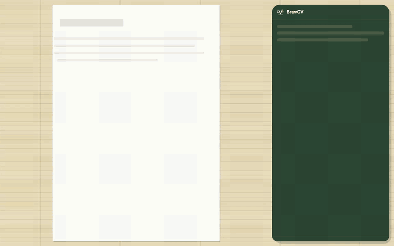

## From the quiet onboarding to the editor

The quiet onboarding turns into the editor as you finish it.

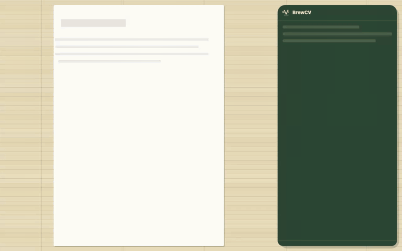

## Tea to coffee

The logo switches Tea and Coffee. Colours fade, and corners, edges and shadows morph as the look changes.

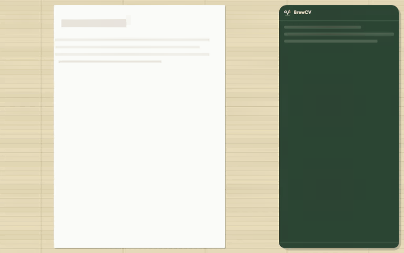

## Coffee to tea

The same switch the other way.

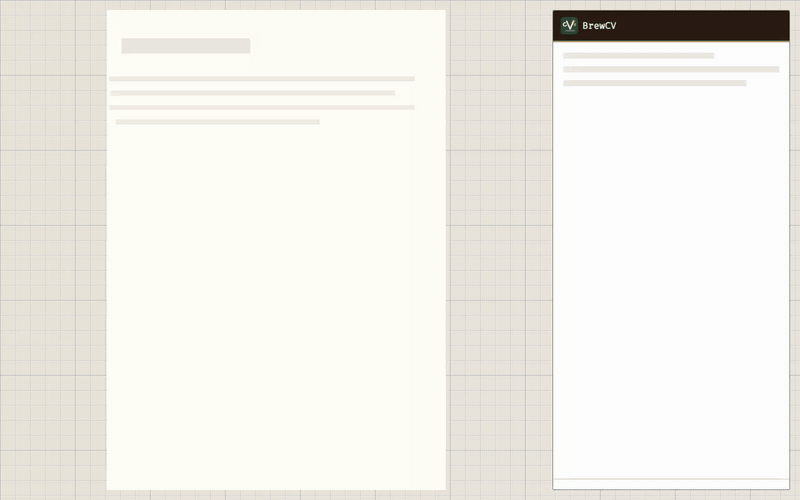

## Export, in tea

Each drink has its own picture of an export: in Tea the page is wrapped in the bamboo mat.

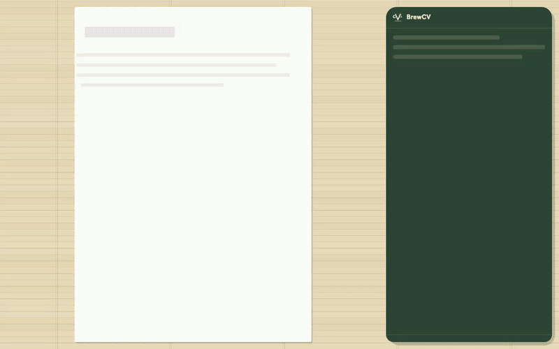

## Export, in coffee

In Coffee the export is a till receipt.

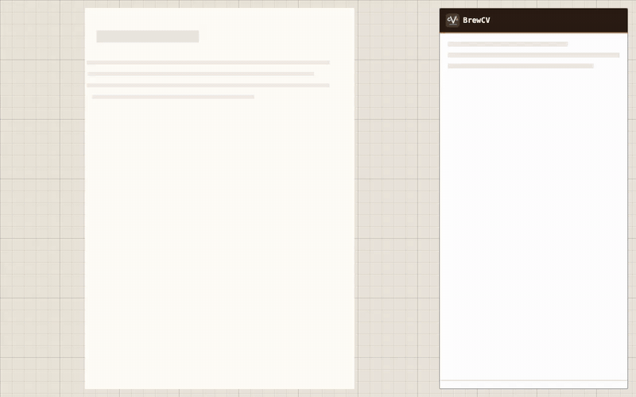
